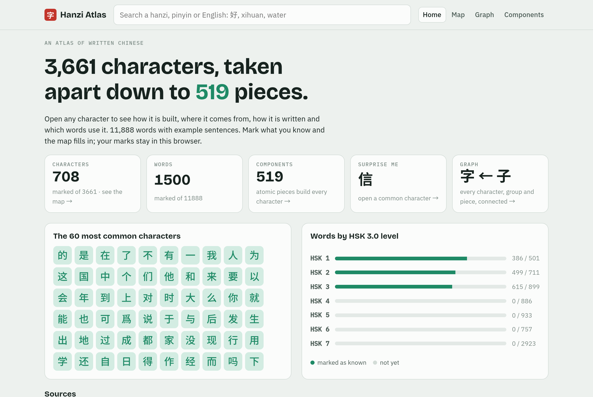
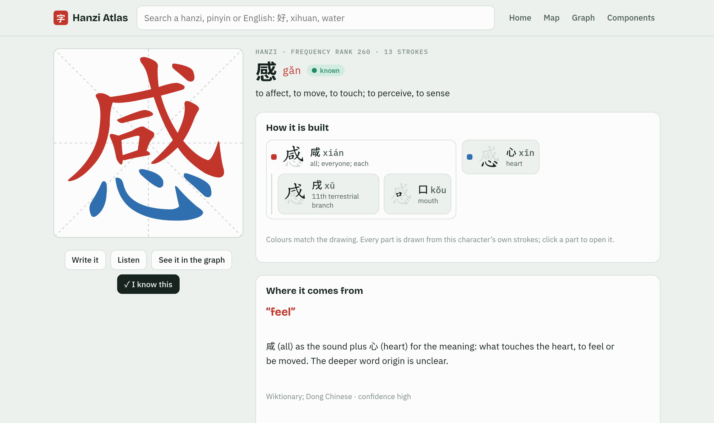
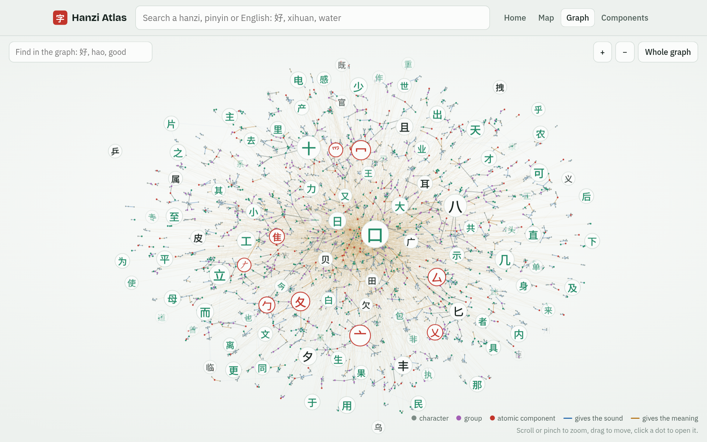
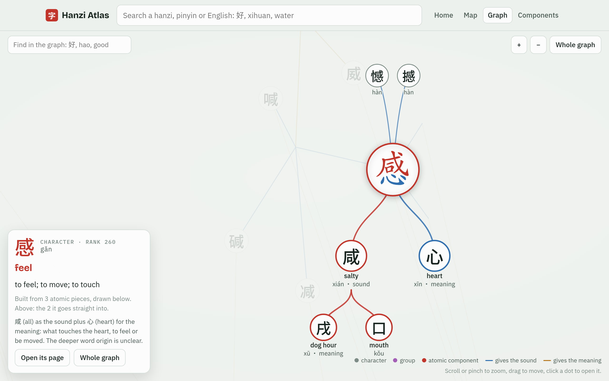
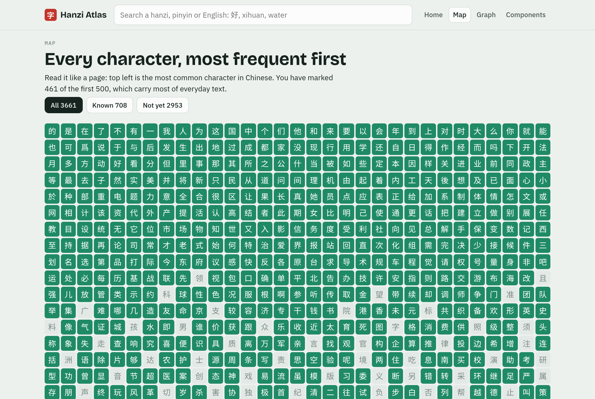
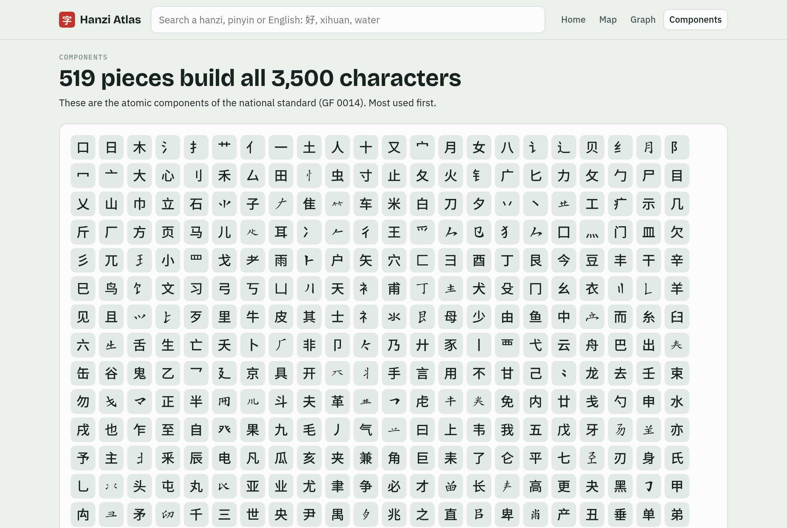
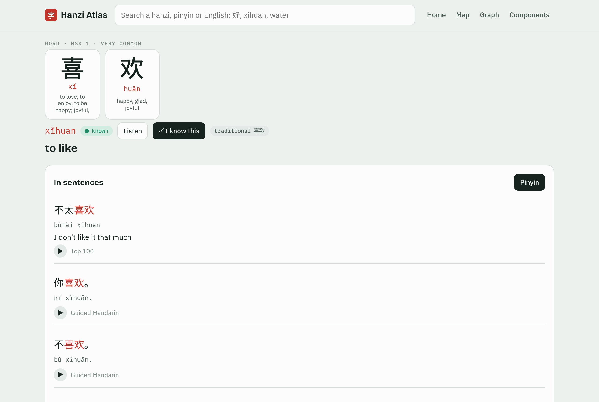
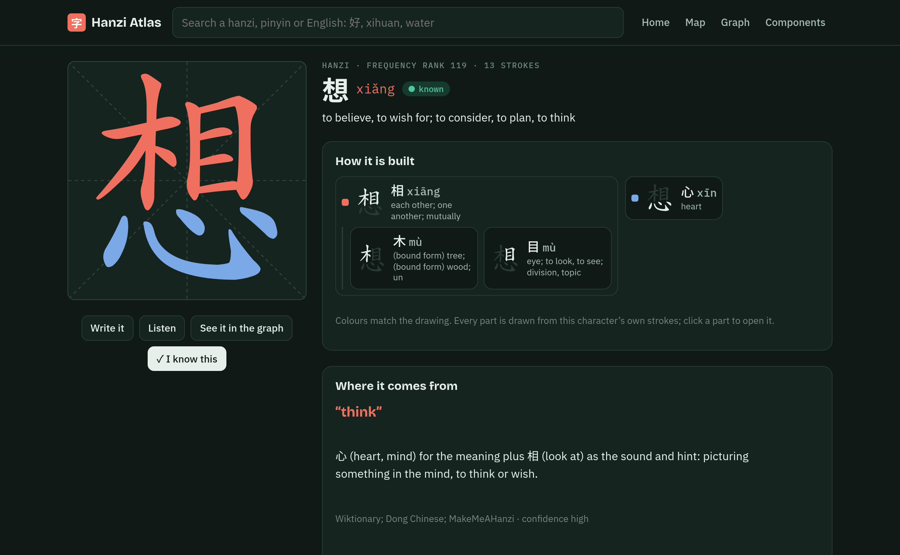
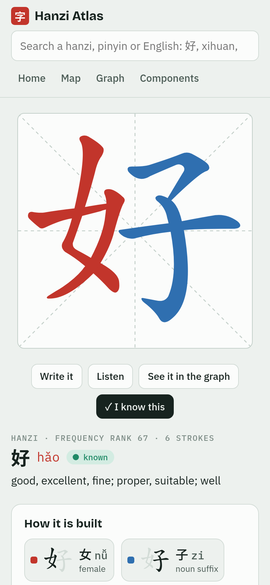

# Hanzi Atlas

**An atlas of written Chinese: 3,661 characters, taken apart down to 519 pieces.**

Open any character to see how it is built, where it comes from, how it is written and which words use it.

**→ [andres-briones.github.io/hanzi-atlas](https://andres-briones.github.io/hanzi-atlas/)**

[](https://andres-briones.github.io/hanzi-atlas/)

## What is in it

### A page for every character

Each character is drawn from its own strokes, with every part in its own colour. The same colours run through the
decomposition tree next to it, so you see which strokes belong to which part. Below that: a short origin note
(which part gives the meaning, which gives the sound, and how well the sound part still works today), a pet name
to remember it by, the characters it appears inside, the words that use it, and example sentences.
"Write it" plays the stroke order.

[](https://andres-briones.github.io/hanzi-atlas/#h-611f)

### The graph

Every character, group and atomic component on one canvas: 4,058 nodes and 7,138 "is part of" links. Click a
node to see its parts below it and everything it builds above it. Blue links give the sound, orange links the
meaning.

| The whole graph | One character's neighbourhood |
|---|---|
| [](https://andres-briones.github.io/hanzi-atlas/#graph) | [](https://andres-briones.github.io/hanzi-atlas/#graph-h-611f) |

### The map

All characters on one page, most frequent first. Mark what you know and the map fills in, so you see how far into
everyday text you are. Marks are kept in your browser only; there is no account and nothing is sent anywhere.

[](https://andres-briones.github.io/hanzi-atlas/#map)

### Components and words

| The 519 atomic components | A word with its sentences |
|---|---|
| [](https://andres-briones.github.io/hanzi-atlas/#parts) |  |

The components are those of the national standard GF 0014-2009. Words (11,888, with their HSK 3.0 level) come
with pinyin, English and 4,557 example sentences; "Listen" uses your browser's speech synthesis.

### Dark mode and phones

| Dark | Phone |
|---|---|
|  |  |

The page follows your system's light or dark setting.

## In numbers

| | |
|---|---|
| Characters | 3,661 — the 3,500 of level 1 of the *Table of General Standard Chinese Characters* have a full tree, origin note and pet name |
| Atomic components | 519 |
| Groups (parts that are not characters in common use) | 345, each with its own page |
| Words | 11,888, HSK 3.0 levels 1 to 7 |
| Example sentences | 4,557 |

## How the trees were made

A character is split into the standard's components using its stroke data, then the parts are grouped into a
tree (感 = 咸 [戌 + 口] + 心) by these rules:

- A group is kept when it is shared: seen in at least two of the 3,500 characters.
- Where two groupings are possible, the character's origin decides.
- Where the origin is silent, a shared group wins over one seen only once.

Every part in a tree is drawn from the strokes of the character it sits in, not from a font, so it looks the
way it does in that character.

## A word of caution

The origin notes and pet names were written with AI assistance from the cited sources, and each note states its
confidence (high, medium or low). Where scholars disagree, the note gives both readings. Treat them as a starting
point for memory, not as a reference for etymology.

## Run it yourself

No build step and no server code: `index.html` plus JSON files under `data/` (about 16 MB).

```sh
git clone https://github.com/Andres-Briones/hanzi-atlas.git
cd hanzi-atlas
python3 -m http.server
```

Then open http://localhost:8000. To host your own copy, push the folder to a GitHub repository and turn on
Settings → Pages → "Deploy from a branch" (`main`, `/ (root)`). All links are relative, so it works under any
sub-path; `.nojekyll` tells GitHub to serve the files as they are.

Pages can be linked directly: `#h-<code point in hex>` for a character (`#h-611f` is 感), `#graph-h-<hex>` for
its place in the graph, `#map`, `#graph`, `#parts`.

## Sources and licences

Stroke data from [Make Me a Hanzi](https://github.com/skishore/makemeahanzi), word meanings from
[CC-CEDICT](https://cc-cedict.org/), decomposition data from [cjkvi IDS](https://github.com/cjkvi/cjkvi-ids),
origin notes drawn from [Wiktionary](https://en.wiktionary.org/) and [Dong Chinese](https://www.dong-chinese.com/),
sentences from [Tatoeba](https://tatoeba.org/) and others. The full list with licences is in
[NOTICE.md](NOTICE.md).
